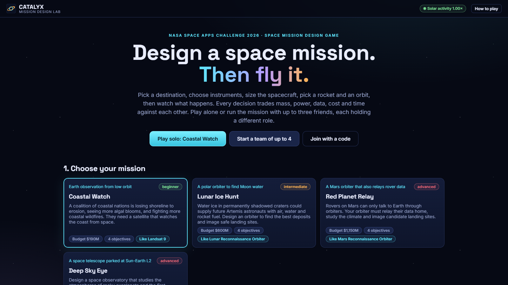
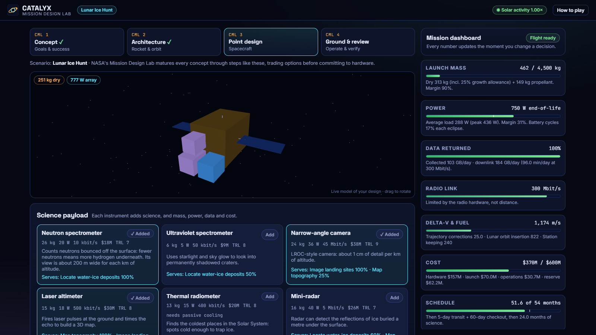
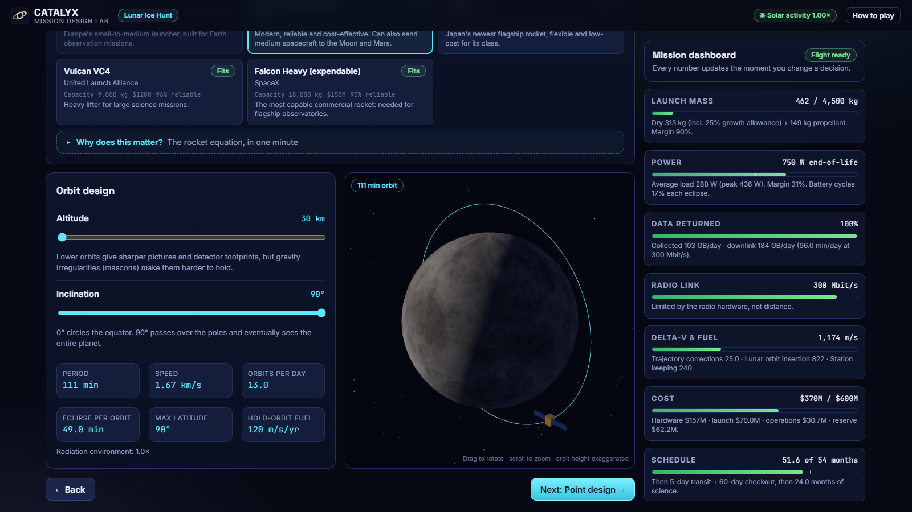
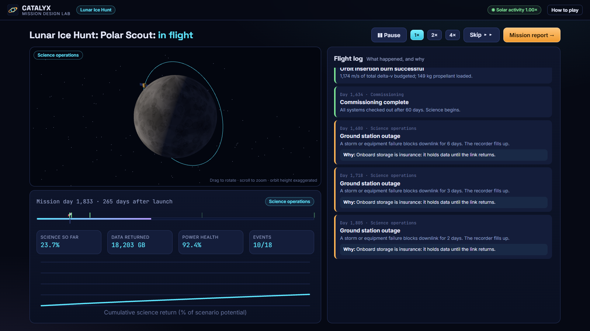
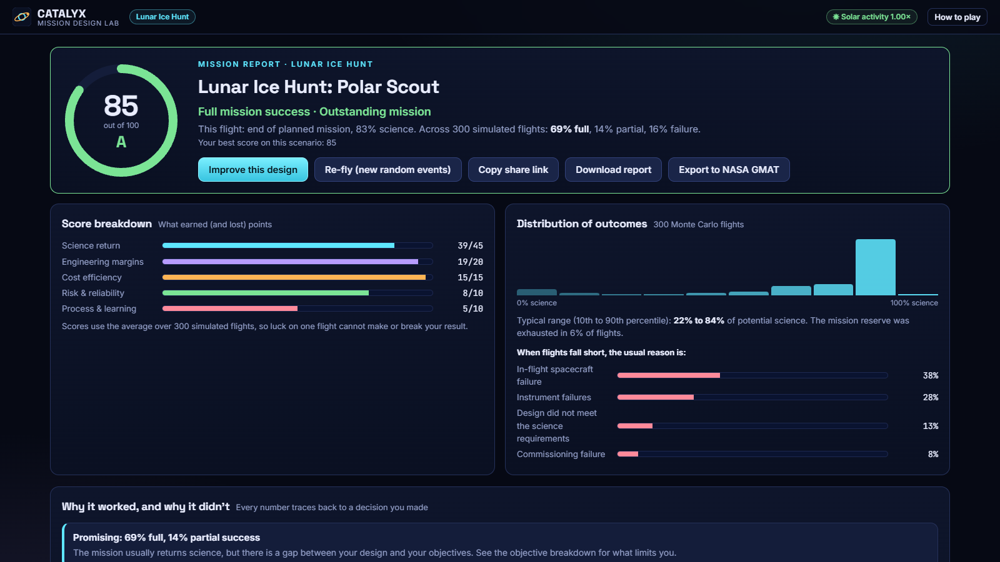
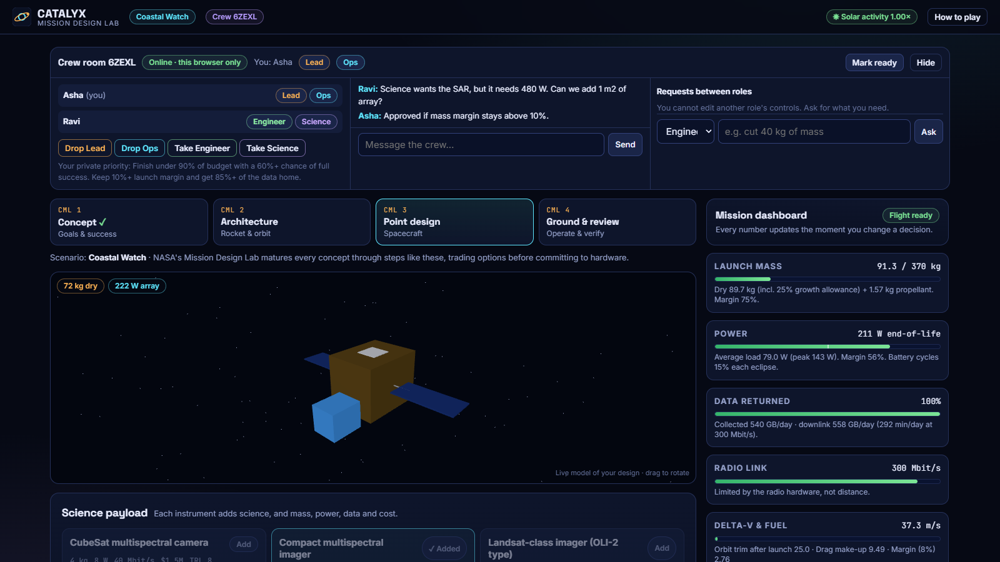

# CATALYX: Mission Design Lab

**A space-mission design game for the NASA Space Apps Challenge 2026** ("Space Mission Design Game" challenge).

Design a complete space mission from concept to operations. Choose science goals, a launch vehicle and orbit, instruments, power, radio, pointing and propulsion. Then fly it through random failures and get a debrief that explains *why* it worked or failed. Play alone, or run the mission as a team of up to four, each with a different role.

> **Play it:** see the project link in the Space Apps submission (also in this repository's "About" section).
> **Team:** Project CATALYX.

---



| Design lab | 3D orbit view | Flight with explained events |
| --- | --- | --- |
|  |  |  |

| Debrief report | Team of four |
| --- | --- |
|  |  |

---

## What the challenge asked for, and where to find it

Every item in the "Objectives" and "Potential considerations" of the official challenge text, and where it lives in the game:

| Challenge item | In the game |
| --- | --- |
| Define a mission objective and requirements | **CML 1 Concept**: choose science objectives (with partial/full success criteria) and mission length |
| Design spacecraft: structure, power, batteries, communications, **onboard computers**, attitude control, instruments | **CML 3 Point design**: bus class (structure), solar cells and array, battery, radio band / dish / power / storage, **onboard computer (basic, standard, advanced: compression and autonomy)**, ADCS, propulsion, thermal, redundancy, parts quality, telescope mirror |
| Scientific instruments with mass, power, cost, data generation and science value | 23 instruments across the four scenarios; each shows mass, power, data rate, cost, TRL and exactly which objectives it serves |
| Simple vs advanced components depending on difficulty | **Simple / Advanced view** toggle (defaults by difficulty); advanced options are hidden in the simple view |
| Several orbit options with explained characteristics | **CML 2**: altitude, inclination, sun-synchronous and local time; live period, speed, eclipse, orbits per day, latitude reach, natural lifetime and radiation |
| Launch vehicles with capacity, cost and orbit capability, and a **mass and orbit compatibility check** | **Launch-vehicle trade study** (8 vehicles): capacity is computed for the chosen orbit and checked against launch mass (red blocker if too heavy) |
| Resources: mass, power, budget, data, communications, time | Live **Mission dashboard** for all of them (plus delta-v, schedule and reliability); each scenario marks its **critical resources** with a star |
| Mission simulation and evaluation system | Narrated flight plus 300 Monte Carlo flights; score from science, margins, cost, risk and process/teamwork |
| Clear feedback on *why* a mission succeeds or fails | Debrief with ranked causes, limiting factor per objective, requirement-verification matrix, "Why does this matter?" cards, red/amber checks that explain themselves |
| Interactive: modify the design and simulate many times | Edit freely, **re-fly** with new random events, save designs, compare them |
| Team mode for up to four, with roles, negotiation, coordination | **Crew rooms**: 4 roles with different controls, chat, **requests between roles**, private priorities, shared go/no-go; the team score depends on how many role priorities the crew satisfies together |
| Different difficulty levels, mission types, scenarios | 4 scenarios (Earth, Moon, Mars, L2), Cadet / Engineer / Flight Director, plus **Sandbox** |
| Random events or unexpected mission constraints | Solar storms, dust storms, micrometeoroids, instrument and wheel failures, ground outages, cost growth, and **Mission Control twists** (budget cut, solar maximum, rocket reassigned, extended mission, supplier delay) |
| Mission dashboards showing real-time resource consumption | **Live telemetry** during flight: battery charge through each eclipse, data recorder filling and emptying, propellant remaining, array output |
| Interactive spacecraft visualisations | Live 3D spacecraft that changes with every decision, 3D orbit viewer (Earth, Moon, Mars, L2), ground-track map |
| Leaderboards or mission rankings | **Leaderboard** on the home screen per scenario, with a benchmark score to beat, plus a **daily challenge** (same scenario and curveball for everyone each date) with a streak counter and 14 **badges** |
| Mission reports at the end of each simulation; post-mission analysis | Downloadable report, score ring, outcome distribution and causes of shortfall |
| Save, share and compare designs | Save slots, side-by-side **Compare** (including designs imported from a friend's share link), share link |
| Competitive scenarios where teams solve the same objective | Same scenario for everyone; share links and the leaderboard let teams compare results |
| Sandbox mode without predefined constraints | **Sandbox** difficulty removes the practical budget cap |
| Educational value: simple explanations, tutorials, visual indicators, optional learning resources | Welcome briefing, **next-step coaching**, "Why does this matter?" cards, a searchable **glossary**, links to NASA learning resources, in-flight **Mission Control decisions** (solar storm, instrument fault) where your call changes the outcome; **what-if previews** on every option (hover to see the change in mass, power, cost, data, reliability before choosing) and **change chips** on the dashboard |
| Explain *why* a decision affects performance, not just right or wrong | Every check has a "Why" and a "Try" line; the debrief names the limiting number; the **Mission Coach** tries about a hundred one-change variants of your design with the real evaluator and shows which raises your expected score, with before/after numbers for mass, power, data, cost and reliability, and an Apply button |

## The four scenarios

| Scenario | Level | Destination | Real mission to compare |
| --- | --- | --- | --- |
| Coastal Watch | beginner | Low Earth orbit | Landsat 9 |
| Lunar Ice Hunt | intermediate | Lunar polar orbit | Lunar Reconnaissance Orbiter |
| Red Planet Relay | advanced | Mars orbit (with optional aerobraking) | Mars Reconnaissance Orbiter |
| Deep Sky Eye | advanced | Sun-Earth L2 telescope | James Webb Space Telescope |

## NASA data and methods used

NASA data is built into how the game works, not added as decoration.

* **NASA DONKI space weather (live, via api.nasa.gov):** the last 30 days of coronal mass ejections and geomagnetic storms set a *solar-activity multiplier*. It scales atmospheric drag (orbit lifetime and delta-v for drag make-up) and how often radiation storms strike in every simulated flight.
* **NASA Concept Maturity Levels (JPL) and the Mission Design Lab process:** the four design steps follow CML 1-4 and the "trade study → point design" progression.
* **NASA's four mission segments (launch, space, ground, user)** from *Design and Develop Science Missions*: used to structure the design and the ground segment.
* **NASA CubeSat 101** form factors inform the CubeSat bus class.
* **NASA mission references:** Landsat 9, LRO, MRO and JWST are used as reference missions you compare against.
* **NASA Blue Marble imagery of Earth** is displayed in the 3D orbit viewer (see References).
* **NASA GMAT:** the report can export your orbit as a starter script for the General Mission Analysis Tool. *The exported script follows GMAT's documented script language but has not been run inside GMAT in this build.*
* **NASA Exoplanet Archive:** published values for nearby temperate rocky planets appear as science targets in the L2 telescope scenario.

## How the physics works (so judges can check it)

All maths is in [`src/engine`](src/engine) and unit-tested (`npm test`).

* Two-body orbital mechanics: period, speed, eclipse fraction, Hohmann transfers, sun-synchronous inclination from J2 nodal precession, capture delta-v from hyperbolic arrival.
* **Rocket equation** sizes propellant backwards through a delta-v budget (insertion, station keeping, drag make-up, disposal) with tank mass, 25-30% mass growth allowance, and iteration.
* **Atmospheric drag** with a log-interpolated density table scaled by solar activity; natural orbital lifetime by integration.
* **Ground contacts**: a circular orbit is propagated over four RAAN values with Earth rotation to count real passes, contact minutes and the longest gap for each chosen station.
* **Link budget in dB**: EIRP, dish gain, free-space path loss, atmospheric loss, ground G/T, coding margin, pointing loss from the ADCS vs beamwidth, and hardware rate caps.
* **Power**: array output with packing and degradation, eclipse energy balance, battery depth-of-discharge and cycle life.
* **Science**: resolution scales with altitude, revisit = Earth circumference / (swath × orbits per day), latitude reach from inclination, pointing accuracy, cooling needs, mirror aperture, downlink for relay objectives.
* **Reliability and Monte Carlo**: launch success, arrival risk, exponential failure model with redundancy / parts / radiation, instrument anomalies, cost-growth uncertainty against the cost reserve.

Launch-vehicle capacities, instrument and component numbers are **rounded educational approximations** of public references, not mission-planning data.

## Run it locally

```bash
npm install
npm run dev        # http://127.0.0.1:5173
npm test           # engine unit tests
npm run build      # type-check + production build
```

### Optional environment variables

| Variable | Purpose |
| --- | --- |
| `VITE_SUPABASE_URL`, `VITE_SUPABASE_ANON_KEY` | Optional. Uses Supabase Realtime *broadcast* channels (no database tables) for team rooms. Without them the game uses **peer-to-peer WebRTC (PeerJS)**: the room host's browser relays messages, so teammates on other devices can join with the invite link. If neither can connect, rooms sync across tabs of the same browser. |
| `VITE_NASA_API_KEY` | Your own api.nasa.gov key (defaults to `DEMO_KEY`). |

## Project layout

```
src/engine     physics, evaluation, simulation, scoring, GMAT export, NASA data
src/data       components, instruments, launchers, ground stations, scenarios, roles
src/state      app store (solo + team state)
src/team       realtime transport for team rooms
src/ui         screens: home, lab, flight, report, team dock, 3D views
scripts        balance tools (probe + optimiser used to tune scoring)
```

## Super Intelligence (SI) acknowledgement

In line with the Space Apps rules, we disclose that **SI tools (a large language model coding assistant) were used extensively in this project**: to propose and refine the game design (scenarios, scoring, roles), and to write and review the source code, unit tests, demo-deck layout and documentation. The team chose the challenge, directed the work, and is responsible for the submission. No NASA logos, flags or mission identifiers are used. No SI-generated images or audio are included: every screenshot in `docs/` is a capture of the running game.

## References and credits

* NASA, *Design and Develop Science Missions* (systems-engineering overview): https://www.nasa.gov/wp-content/uploads/2025/04/250323-design-and-develop-science-mission.pdf
* NASA JPL, *Concept Maturity Levels*: https://dataverse.jpl.nasa.gov/dataset.xhtml?persistentId=hdl:2014/44299
* NASA Goddard, Mission Design Lab: https://etd.gsfc.nasa.gov/capabilities/integrated-design-center/mission-design-lab/
* NASA, *CubeSat 101*: https://www3.nasa.gov/sites/default/files/atoms/files/nasa_csli_cubesat_101_508.pdf
* NASA, General Mission Analysis Tool (GMAT): https://software.nasa.gov/software/GSC-19468-1
* NASA DONKI space-weather API: https://api.nasa.gov/
* NASA Exoplanet Archive: https://exoplanetarchive.ipac.caltech.edu/
* NASA Visible Earth / Blue Marble imagery (public domain), loaded at runtime from the `three-globe` package assets on unpkg: https://github.com/vasturiano/three-globe
* Libraries: React, Vite, Three.js, Zustand, PeerJS, Supabase JS (all open source, MIT licence). Peer-to-peer connection set-up uses the public PeerJS broker.
* Fonts: Inter, Space Grotesk, JetBrains Mono (Google Fonts, SIL Open Font Licence).
* Reference missions: Landsat 9 (landsat.gsfc.nasa.gov), LRO (science.nasa.gov/mission/lro), MRO (science.nasa.gov/mission/mars-reconnaissance-orbiter), JWST (science.nasa.gov/mission/webb).
